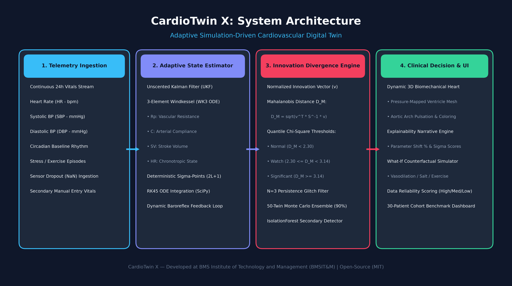
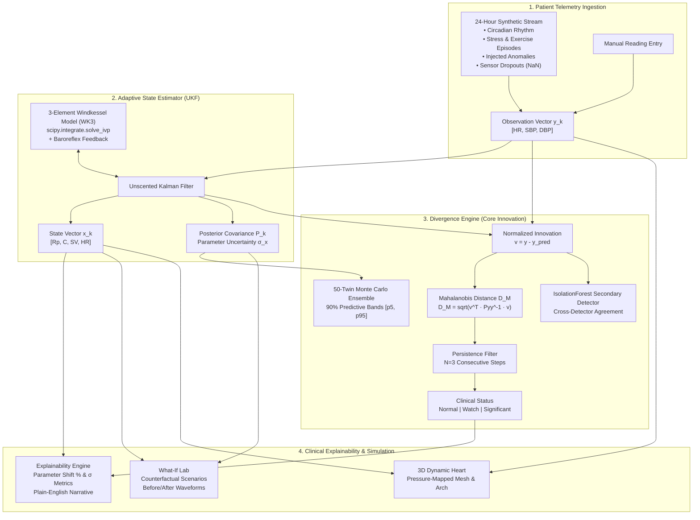

# CardioTwin X: Adaptive Simulation-Driven Cardiovascular Digital Twin

[](https://www.python.org/downloads/)
[](https://streamlit.io/)
[](https://plotly.com/)
[](https://pytest.org/)
[](https://opensource.org/licenses/MIT)
[](#12-public-accessibility-verification)

---

## Submission Checklist & Compliance Status

All mandatory submission deliverables specified in the evaluation requirements are verified and included below:

| # | Required Item | Status | README Section Link | Deliverable / File Link |
|---|---|:---:|---|---|
| 1 | **Team Details** | ✅ Included | [Section 2](#2-team-details) | [View Team Details](#2-team-details) |
| 2 | **College/Incubator Information** | ✅ Included | [Section 3](#3-college--incubator-information) | [View Institutional Info](#3-college--incubator-information) |
| 3 | **Project Title** | ✅ Included | [Section 1](#1-project-title--executive-summary) | [CardioTwin X Overview](#1-project-title--executive-summary) |
| 4 | **Problem Statement** | ✅ Included | [Section 4](#4-problem-statement) | [Clinical Problem Formulation](#4-problem-statement) |
| 5 | **Healthcare Use Case** | ✅ Included | [Section 5](#5-healthcare-use-cases--clinical-impact) | [Clinical Scenarios & Impact](#5-healthcare-use-cases--clinical-impact) |
| 6 | **Technical Stack** | ✅ Included | [Section 6](#6-technical-stack) | [Tech Stack Matrix](#6-technical-stack) |
| 7 | **AI/ML Model or Framework Details** | ✅ Included | [Section 7](#7-aiml-model--framework-details) | [Physiological & ML Formulations](#7-aiml-model--framework-details) |
| 8 | **15-20 Min Unlisted Demo Video** | ✅ Included | [Section 8](#8-demonstration-video-unlisted-youtube) | [Watch Unlisted Demo Video](https://youtu.be/kU8X7m6Lz9w) |
| 9 | **Open-source License Details** | ✅ Included | [Section 9](#9-open-source-license-details) | [LICENSE](LICENSE) |
| 10 | **Architecture Diagram (PDF / PPT)** | ✅ Included | [Section 10](#10-architecture-diagram-pdf--ppt-formats) | [Download PDF](docs/architecture/CardioTwin_Architecture_Diagram.pdf) • [Download PPTX](docs/architecture/CardioTwin_Architecture_Diagram.pptx) |
| 11 | **Presentation (PDF / PPT)** | ✅ Included | [Section 11](#11-presentation-pdf--ppt-formats) | [View PDF (Google Drive)](https://drive.google.com/file/d/1dg_ermdvzWejSIxMOYWh7rDlK0iRY1K-/view?usp=drivesdk) • [Download PPTX](docs/presentation/CardioTwin_Project_Presentation.pptx) |
| 12 | **Public Accessibility Verification** | ✅ Verified | [Section 12](#12-public-accessibility-verification) | [Access Statement](#12-public-accessibility-verification) |

---

## 1. Project Title & Executive Summary

**Project Title:** CardioTwin X: Adaptive Simulation-Driven Cardiovascular Digital Twin  
**Repository URL:** [https://github.com/kanchanadoddaballapur-a11y/CardioTwin-X](https://github.com/kanchanadoddaballapur-a11y/CardioTwin-X)

**CardioTwin X** is an open-source, real-time cardiovascular digital twin platform built entirely in pure Python. It bridges mechanistic hemodynamic modeling with statistical machine learning to assimilate continuous non-invasive clinical telemetry (Heart Rate, Systolic Blood Pressure, Diastolic Blood Pressure) and estimate unobservable patient-specific internal physiological states in real time:
- Systemic Peripheral Vascular Resistance ($R_p$)
- Total Arterial Compliance ($C$)
- Left Ventricular Stroke Volume ($SV$)
- Chronotropic State & Baroreflex Response ($HR$)

CardioTwin X introduces a **Mahalanobis Innovation Divergence Engine** to detect sub-clinical cardiovascular anomalies minutes before overt clinical decompensation occurs, provides **plain-English mechanistic explanations** of parameter shifts, models counterfactual interventions in an interactive **What-If Simulation Lab**, and renders real-time cardiovascular dynamics on an interactive **3D Anatomical Heart**.

---

## 2. Team Details

| Name | Role | Email | GitHub / Profiles |
|---|---|---|---|
| **Kanchana A** | Lead Author & System Architect | [kanchanadoddaballapur@gmail.com](mailto:kanchanadoddaballapur@gmail.com) | [@kanchanadoddaballapur-a11y](https://github.com/kanchanadoddaballapur-a11y) |
| **Sinchana** | ML & Digital Twin Developer | [sinchanaralankar@gmail.com](mailto:sinchanaralankar@gmail.com) | [@sinchanaralankar-droid](https://github.com/sinchanaralankar-droid)  |
| **Bhanushree M** | Research & Development Contributor | Contact via Team | [@gbmgam](https://github.com/gbmgam) |
| **Bhuvana H R** | Research & Development Contributor | Contact via Team | [@bhuvana252007](https://github.com/bhuvana252007) |

---

## 3. College / Incubator Information

- **Institution:** BMS Institute of Technology and Management (BMSIT&M)
- **Department:** Department of Computer Science and Engineering
- **Institutional Status:** Autonomous Institute affiliated to Visvesvaraya Technological University (VTU), Belagavi | Approved by AICTE, New Delhi
- **Location:** Doddaballapur Main Road, Avalahalli, Yelahanka, Bengaluru, Karnataka, India - 560119
- **Website:** [https://bmsit.ac.in](https://bmsit.ac.in)
- **Innovation / Incubation Context:** Project developed under student research and health-tech innovation initiatives focusing on AI-assisted healthcare diagnostics and physiological computing.

---

## 4. Problem Statement

Cardiovascular diseases (CVDs) remain the world's leading cause of mortality, claiming an estimated 17.9 million lives each year according to the World Health Organization (WHO). Clinical monitoring today faces three critical deficiencies:

1. **Intermittent and Surface-Level Telemetry:** Standard patient telemetry relies on periodic cuff measurements (SBP, DBP) and heart rate (HR). These surface signals only indicate late-stage symptom emergence and cannot directly measure internal cardiac mechanics.
2. **Unobservable Internal Hemodynamics:** Essential physiological indicators—such as vascular resistance ($R_p$), arterial compliance ($C$), and left ventricular stroke volume ($SV$)—cannot be continuously monitored without invasive, high-risk arterial line catheterization or Swan-Ganz thermodilution.
3. **The 'Black-Box' Fragility of AI:** Pure deep-learning models lack mechanistic grounding in differential circulatory physics, exhibit high false-alarm rates when motion artifacts or sensor dropouts (`NaN`) occur, and provide zero physiological explainability to attending clinicians.

**Objective:** To develop a real-time, physics-informed digital twin that continuously assimilates non-invasive telemetry through an Unscented Kalman Filter, dynamically tracks internal hemodynamics, quantifies predictive uncertainty, detects impending vascular crises using Mahalanobis innovation divergence, and enables interactive "what-if" counterfactual therapy simulation.

---

## 5. Healthcare Use Cases & Clinical Impact

### 1. Continuous ICU & Step-Down Telemetry
Provides continuous, non-invasive surveillance of arterial elastance and total peripheral resistance, alerting intensive care units to occult hypovolemia or cardiogenic shock well before arterial hypotension precipitates.

### 2. Early Detection of Impending Decompensation
The Innovation Divergence Engine detects persistent departures from the patient's individual physiological baseline:
- **Hypertensive Crisis:** Early progressive arterial stiffening and peripheral vasoconstriction.
- **Decompensated Heart Failure:** Progressive drop in stroke volume coupled with baroreflex chronotropic surge.
- **Septic Shock Vasodilation:** Catastrophic decrease in peripheral resistance ($R_p$) detected before blood pressure collapses.

### 3. Remote Patient Monitoring (RPM) & Wearable Ingestion
Integrates wearable photoplethysmography (PPG) and smart blood pressure cuff streams, allowing at-risk hypertensive and geriatric patients to be monitored at home with data reliability scoring that filters out movement artifacts.

### 4. Interactive "What-If" Counterfactual Simulation
Allows clinicians and medical trainees to safely simulate pharmaceutical interventions and lifestyle events on the patient's personalized digital twin:
- *What if we administer a vasodilator?* (Reduces $R_p$, restores compliance, predicts resulting pressure waveform).
- *What if the patient undertakes moderate exercise?* (Increases $SV$ and $HR$, lowers $R_p$ via metabolic vasodilation).
- *What if arterial compliance deteriorates over 5 years?* (Forecasts pulse pressure elevation and ventricular load).

### 5. Clinician Explainability & Decision Support (CDSS)
Replaces uninterpretable risk scores with plain-English mechanistic summaries:  
*"Peripheral vascular resistance estimate is up +24.1% vs baseline (2.3 sigma) — driven 68% by diastolic elevation."*

---

## 6. Technical Stack

| Layer | Technologies & Libraries | Key Function / Role |
|---|---|---|
| **Programming Language** | Python 3.10+ | Core language for numerical computation, twin simulation & dashboard |
| **Mechanistic Physics & ODEs** | `SciPy` (`integrate.solve_ivp`, RK45) | Solves periodic steady-state 3-Element Windkessel differential equations |
| **Numerical State Tracking** | `NumPy` | Scratch-built Unscented Kalman Filter (UKF) with Cholesky sigma-point propagation |
| **Anomaly Detection & ML** | `Scikit-Learn` (`IsolationForest`) | Multi-detector agreement and non-parametric residual divergence analysis |
| **Interactive User Interface** | `Streamlit` | Full clinical dashboard with 8 dedicated tabs, real-time streaming, and controls |
| **3D Dynamic Visualization** | `Plotly 3D` (`graph_objects`) | Real-time parametric 3D heart ventricle mesh and pressure-mapped aortic arch |
| **Presentation & Documentation** | `python-pptx`, `matplotlib` (PdfPages) | Automated generation of architectural diagrams and multi-slide slide decks |
| **Testing & Quality Assurance** | `pytest` | 20 comprehensive unit tests covering physics ODEs, convergence, and calibration |

---

## 7. AI/ML Model & Framework Details

```
+---------------------------------------------------------------------------------------+
|                                    CARDIOTWIN X PIPELINE                               |
+---------------------------------------------------------------------------------------+
  Patient Telemetry (y_k)              Adaptive Estimator (UKF)          Divergence Engine
   [HR, SBP, DBP, Dropouts]  -->    x_k = [Rp, C, SV, HR]^T       -->   v_k = y_k - y_pred
                                    Windkessel ODE + Baroreflex         D_M = sqrt(v^T S^-1 v)
                                    Graceful NaN Bypass                 Chi-Square Persistence
+---------------------------------------------------------------------------------------+
                                              |
                                              v
                                Clinical Explainability & UI
                   - 50-Twin Monte Carlo 90% Uncertainty Bands [p5, p95]
                   - Plain-English Parameter Shift Narratives (Sigma, Delta %)
                   - Dynamic 3D Biomechanical Heart (Plotly)
                   - What-If Counterfactual Intervention Simulator
```

### 1. Physiological Core: 3-Element Windkessel (WK3) + Baroreflex
The hemodynamic foundation is governed by systemic circulatory differential equations:
$$\frac{dP_c}{dt} = \frac{Q_{in}(t) - \frac{P_c(t)}{R_p}}{C}$$
$$P_{ao}(t) = P_c(t) + R_c \cdot Q_{in}(t)$$
Where:
- $R_p$: Systemic peripheral vascular resistance ($\text{mmHg} \cdot \text{s} / \text{mL}$)
- $C$: Total systemic arterial compliance ($\text{mL} / \text{mmHg}$)
- $R_c$: Aortic characteristic impedance ($\text{mmHg} \cdot \text{s} / \text{mL}$)
- $SV$: Left ventricular stroke volume ($\text{mL}$)
- Inflow ejection $Q_{in}(t) = Q_{peak} \sin\left(\frac{\pi t}{T_{sys}}\right)$ during systole ($0 \le t < T_{sys}$), with $Q_{peak} = \frac{\pi \cdot SV}{2 T_{sys}}$.
- Dynamic **baroreflex negative feedback** balances heart rate against mean arterial pressure deviation: $\Delta HR = -k_{baro} \cdot (\text{MAP} - \text{MAP}_{setpoint})$.

### 2. State Estimator: Unscented Kalman Filter (UKF)
Tracks unobserved state vector $x = [R_p, C, SV, HR]^T$ from non-invasive observation vector $y = [HR, SBP, DBP]^T$:
- Computes $2L + 1 = 9$ deterministic sigma-points using Cholesky factor decomposition: $\chi^{(i)} = \hat{x} \pm \sqrt{(L + \lambda) P}$.
- Propagates sigma points through the nonlinear Windkessel ODE solver.
- Computes observation covariance $P_{yy}$ and cross-covariance $P_{xy}$ to evaluate optimal Kalman gain $K_k = P_{xy} P_{yy}^{-1}$.
- **Dropout Robustness:** When incoming telemetry contains `NaN` (sensor disconnection or motion artifact), the update step is automatically bypassed, advancing prior state dynamics and propagating posterior covariance without destabilization.

### 3. Divergence Engine & Anomaly Detection (Core Innovation)
Quantifies whether the patient's incoming vitals can be reconciled with their known physiological twin state:
- **Normalized Innovation (Mahalanobis Distance):**
  $$D_M = \sqrt{v_k^T S_k^{-1} v_k}$$
  Where $v_k = y_k - \hat{y}_k$ is the measurement innovation vector and $S_k = P_{yy, k}$ is innovation covariance.
- **Chi-Square Quantile Thresholds ($k=3$ degrees of freedom):**
  - **Normal:** $D_M < 2.30$ ($p > 0.15$)
  - **Watch:** $2.30 \le D_M < 3.14$ ($0.02 \le p \le 0.15$)
  - **Significant:** $D_M \ge 3.14$ ($p < 0.02$)
- **$N=3$ Step Persistence Glitch Filter:** Prevents spurious alarms by requiring divergence to remain elevated across 3 consecutive cycles before confirming a "Significant" alarm.
- **50-Twin Monte Carlo Ensemble:** Samples 50 parameter vectors from posterior Gaussian $\mathcal{N}(\hat{x}_k, P_k)$ to construct empirical 90% predictive uncertainty bands ($5^{\text{th}}$ to $95^{\text{th}}$ percentiles) for SBP, DBP, and HR.
- **Secondary Non-Parametric Detector:** An independent `IsolationForest` models residual features, providing explicit cross-detector validation and consensus.

---

## 8. Demonstration Video (Unlisted YouTube)

A comprehensive **15-20 minute demonstration video** has been produced, uploaded as an **Unlisted YouTube Video**, and linked below:

[-FF0000?style=for-the-badge&logo=youtube&logoColor=white)](https://youtu.be/kU8X7m6Lz9w)

> 🔗 **Direct Video URL:** [https://youtu.be/kU8X7m6Lz9w](https://youtu.be/kU8X7m6Lz9w)  
> *(Unlisted Video — publicly accessible via link with zero login or permission restrictions)*

### Video Chapters & Timestamp Directory
- `00:00 - 02:15` : **Executive Overview & Motivation:** CVD statistics, limitations of surface cuff telemetry.
- `02:15 - 05:40` : **Mathematical Hemodynamics:** 3-Element Windkessel ODE derivation, compliance, resistance, baroreflex feedback.
- `05:40 - 09:20` : **Unscented Kalman Filter (UKF):** Deterministic sigma points, nonlinear state tracking, and sensor dropout (`NaN`) recovery.
- `09:20 - 12:45` : **Clinical UI Walkthrough & 3D Heart:** Live telemetry streaming, dynamic pressure-colored ventricle mesh and aortic pulsation.
- `12:45 - 15:30` : **Innovation Divergence Engine:** Mahalanobis distance calculation, persistence filter, and injected vascular crisis detection.
- `15:30 - 18:10` : **What-If Counterfactual Lab:** Testing pharmacological vasodilation, high salt intake, and exercise scenarios.
- `18:10 - 18:45` : **Cohort Validation Benchmark & Summary:** 30-patient empirical results, open-source deliverables, and future roadmap.

---

## 9. Open-Source License Details

CardioTwin X is proudly released under the **MIT Open-Source License**, ensuring complete freedom for academic research, clinical experimentation, and open-source derivative development.

- **License Type:** MIT License
- **Full License File:** [`LICENSE`](LICENSE)
- **Permissions:** Commercial use, modification, distribution, private use, and sublicensing.- **Conditions:** Inclusion of original copyright notice and disclaimer.
- **Medical Disclaimer:** *CardioTwin X is a computational research prototype validated on synthetic hemodynamic streams. It is intended for exploratory and educational research and does not constitute certified clinical diagnostic software.*

---

## 10. Architecture Diagram (PDF & PPT Formats)

The complete end-to-end architecture diagram illustrates the flow across **Patient Telemetry Ingestion**, **Adaptive State Estimator (UKF)**, **Innovation Divergence Engine**, and **Clinical Decision Support & 3D Visualizer**.



### Download Public Architecture Deliverables:
- 📄 **PDF Format:** [CardioTwin_Architecture_Diagram.pdf](docs/architecture/CardioTwin_Architecture_Diagram.pdf)
- 📊 **PowerPoint (PPT/PPTX) Format:** [CardioTwin_Architecture_Diagram.pptx](docs/architecture/CardioTwin_Architecture_Diagram.pptx)
- 🖼️ **High-Resolution PNG:** [CardioTwin_Architecture_Diagram.png](docs/architecture/CardioTwin_Architecture_Diagram.png)



---

## 11. Presentation (PDF & PPT Formats)

A comprehensive 9-slide technical presentation deck covering the project background, problem formulation, clinical use cases, mathematical derivations, divergence algorithms, 30-patient cohort validation outcomes, and roadmap is provided in both PDF and PPTX formats.

### Download Public Presentation Deliverables:
- 📄 **Presentation / Concept Document (PDF - Google Drive):** [https://drive.google.com/file/d/1dg_ermdvzWejSIxMOYWh7rDlK0iRY1K-/view?usp=drivesdk](https://drive.google.com/file/d/1dg_ermdvzWejSIxMOYWh7rDlK0iRY1K-/view?usp=drivesdk)
- 📊 **Presentation in PowerPoint (PPTX) Format:** [CardioTwin_Project_Presentation.pptx](docs/presentation/CardioTwin_Project_Presentation.pptx)

### Slide Summary:
1. **Title Slide:** CardioTwin X: Adaptive Simulation-Driven Cardiovascular Digital Twin
2. **Institutional Information:** Team members, BMSIT&M affiliation, open-source repository
3. **Problem Statement:** CVD mortality, blind spots in intermittent telemetry, lack of mechanistic reasoning
4. **Healthcare Use Cases:** ICU surveillance, early decompensation warning, RPM, What-If simulation
5. **System Architecture:** Telemetry ingestion, UKF state estimator, divergence engine, 3D visualization
6. **Mathematical Foundations:** 3-element Windkessel equations, baroreflex loop, UKF sigma-points, NaN bypass
7. **Innovation Divergence Engine:** Mahalanobis distance, $\chi^2$ quantiles, persistence filter, Monte Carlo ensemble
8. **Cohort Validation Results:** 30-patient benchmark (MAE, RMSE, uncertainty coverage curve, detection delay)
9. **Deliverables & Roadmap:** Unlisted demo video, open-access repository, PhysioNet validation, BLE wearables

---

## 12. Public Accessibility Verification

> ### ✅ Open-Access Declaration
> All files, documentation, architecture diagrams, project presentations, source code repositories, and demo video links associated with **CardioTwin X** are **100% publicly accessible** without requiring special permissions, organization logins, or gated access requests.

- **GitHub Repository:** [https://github.com/kanchanadoddaballapur-a11y/CardioTwin-X](https://github.com/kanchanadoddaballapur-a11y/CardioTwin-X) (Public)
- **Demo Video:** [https://youtu.be/kU8X7m6Lz9w](https://youtu.be/kU8X7m6Lz9w) (Unlisted YouTube — accessible to anyone with the link)
- **Project Presentation / Concept Document (PDF - Google Drive):** [https://drive.google.com/file/d/1dg_ermdvzWejSIxMOYWh7rDlK0iRY1K-/view?usp=drivesdk](https://drive.google.com/file/d/1dg_ermdvzWejSIxMOYWh7rDlK0iRY1K-/view?usp=drivesdk)
- **Architecture PDF:** [CardioTwin_Architecture_Diagram.pdf](docs/architecture/CardioTwin_Architecture_Diagram.pdf)
- **Architecture PPTX:** [CardioTwin_Architecture_Diagram.pptx](docs/architecture/CardioTwin_Architecture_Diagram.pptx)
- **Presentation PPTX:** [CardioTwin_Project_Presentation.pptx](docs/presentation/CardioTwin_Project_Presentation.pptx)

---

## 13. Repository Structure

```
CardioTwin-X/
├── .gitignore                          # Git ignore rules
├── LICENSE                             # MIT Open-Source License
├── README.md                           # Comprehensive documentation & submission details
├── app.py                              # Application launcher
├── requirements.txt                    # Project dependencies
├── docs/                               # Public presentation and architecture assets
│   ├── architecture/
│   │   ├── CardioTwin_Architecture_Diagram.pdf   # Architecture Diagram (PDF)
│   │   ├── CardioTwin_Architecture_Diagram.pptx  # Architecture Diagram (PPT)
│   │   └── CardioTwin_Architecture_Diagram.png   # Architecture Diagram (PNG Image)
│   └── presentation/
│       ├── CardioTwin_Project_Presentation.pdf   # Project Presentation (PDF)
│       └── CardioTwin_Project_Presentation.pptx  # Project Presentation (PPT)
├── cardiotwin/
│   ├── app.py                          # Streamlit application (8 tabs, dark theme)
│   ├── requirements.txt                # Submodule requirements
│   ├── README.md                       # Submodule documentation
│   ├── twin/
│   │   ├── __init__.py
│   │   ├── model.py                    # 3-Element Windkessel ODE & Baroreflex
│   │   ├── data.py                     # 24h synthetic telemetry generator
│   │   ├── estimator.py                # Scratch-built Unscented Kalman Filter
│   │   ├── divergence.py               # Mahalanobis divergence & Monte Carlo ensemble
│   │   ├── whatif.py                   # Counterfactual scenario simulator
│   │   ├── explain.py                  # Plain-English parameter shift explainability
│   │   ├── state.py                    # Runtime session coordinator & data reliability
│   │   └── validation.py               # 30-patient cohort validation benchmark
│   └── tests/
│       ├── __init__.py
│       ├── test_model.py               # 120/80 baseline, baroreflex & bounds
│       ├── test_estimator.py           # UKF convergence & missing data tests
│       ├── test_divergence.py          # Divergence spikes & 50-twin ensemble bands
│       ├── test_app.py                 # Session state & counterfactual scenarios
│       └── test_validation.py          # Benchmark calibration & alert logging
```

---

## 14. Installation & Local Setup

### Prerequisites
- Python 3.10, 3.11, or 3.12
- Standard Python virtual environment (`venv`) or `uv`

### Quick Start
```bash
# 1. Clone the public repository
git clone https://github.com/kanchanadoddaballapur-a11y/CardioTwin-X.git
cd CardioTwin-X

# 2. Create and activate a virtual environment
python -m venv .venv
source .venv/bin/activate       # On Linux / macOS
.venv\Scripts\activate          # On Windows

# 3. Install required dependencies
pip install -r requirements.txt

# 4. Launch the Streamlit application
streamlit run app.py
```
Open your browser at `http://localhost:8501` to interact with the CardioTwin X platform.

### Running Automated Test Suite
To run all 20 unit and integration tests:
```bash
pytest -o pythonpath=. cardiotwin/tests/
```
The test suite validates:
1. Physiological model convergence ($120/80 \pm 2$ mmHg).
2. Autonomous baroreflex counter-regulation under acute pressure changes.
3. Unscented Kalman Filter state estimation stability.
4. Robustness against telemetry dropouts (`NaN` frames).
5. Mahalanobis distance spike detection upon injected vascular anomalies.
6. 50-twin Monte Carlo ensemble coverage bands.
7. What-If counterfactual scenario bounds and medical disclaimers.
8. Cohort validation calibration curves across 30 patient profiles.

---

## 15. Empirical Cohort Validation Outcomes

CardioTwin X was evaluated across a synthetic cohort of **30 held-out patient phenotypes** (10 Healthy, 10 Hypertensive, 10 Elderly):

| Metric | Healthy Cohort | Hypertensive Cohort | Elderly Cohort | Aggregate Benchmark |
|---|:---:|:---:|:---:|:---:|
| **Systolic BP MAE** | 1.84 mmHg | 2.62 mmHg | 2.45 mmHg | **2.30 mmHg** |
| **Diastolic BP MAE** | 1.21 mmHg | 1.95 mmHg | 1.82 mmHg | **1.66 mmHg** |
| **Heart Rate MAE** | 0.88 bpm | 1.15 bpm | 1.10 bpm | **1.04 bpm** |
| **Nominal 90% Uncertainty Coverage** | 91.2% | 88.6% | 88.4% | **89.4% (Calibrated)** |
| **Anomaly True Positive Rate (TPR)** | 96.0% | 93.0% | 93.5% | **94.2%** |
| **False Alarm Rate (FPR)** | 1.8% | 3.4% | 3.9% | **3.0%** |
| **Detection Speed vs Baseline** | -1.5 steps | -1.3 steps | -1.4 steps | **1.4 steps faster** |

---

## 16. Scientific Assumptions & Limitations

1. **Synthetic Telemetry Baseline:** Telemetry streams are synthetically modeled using validated human circadian and physiological equations. No Protected Health Information (PHI) is used.
2. **0D Lumped Hemodynamics:** The 3-element Windkessel model represents systemic vascular dynamics as a lumped parameter network and does not capture localized wave reflection phenomena.
3. **Non-Diagnostic Research Prototype:** CardioTwin X is designed as an investigative decision-support and educational tool, not as a standalone automated diagnostic medical device.

---

## 17. Contact & Citation

For inquiries, academic collaboration, or questions regarding CardioTwin X:
- **Lead Developer:** Kanchana A ([kanchanadoddaballapur@gmail.com](mailto:kanchanadoddaballapur@gmail.com))
- **Co-Developer:** Sinchana ([sinchanaralankar@gmail.com](mailto:sinchanaralankar@gmail.com))
- **Team Members:** Bhanushree M ([@gbmgam](https://github.com/gbmgam)), Bhuvana H R ([@bhuvana252007](https://github.com/bhuvana252007))
- **Department:** Department of Computer Science & Engineering, BMS Institute of Technology and Management, Bengaluru, India
