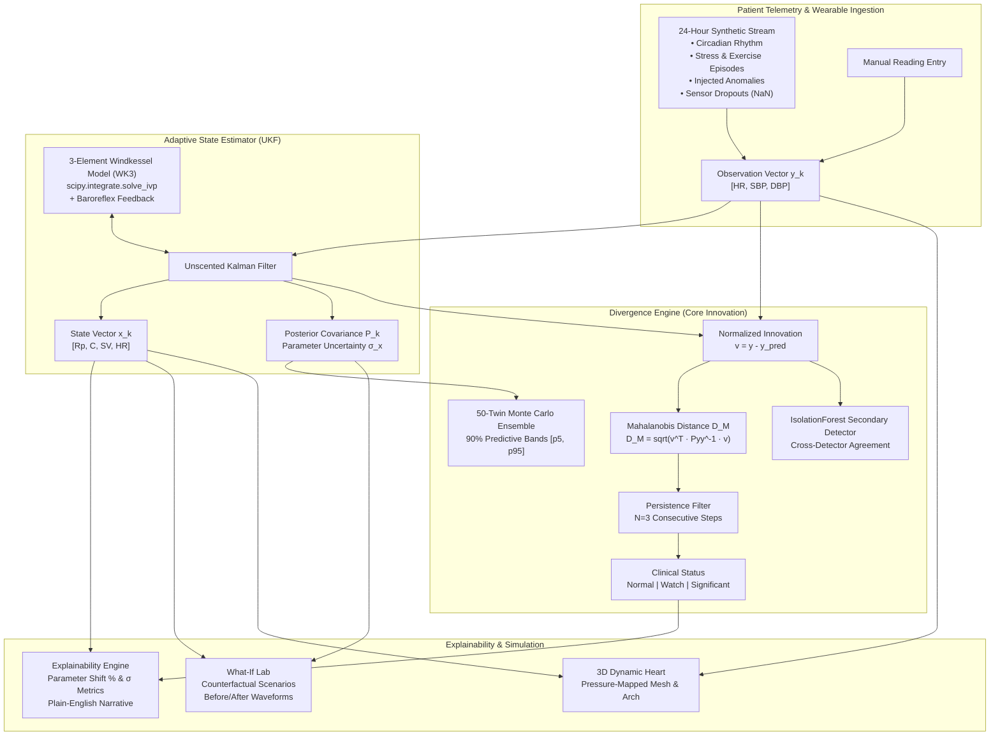

# CardioTwin X: Adaptive Simulation-Driven Cardiovascular Digital Twin

[](https://www.python.org/downloads/)
[](https://streamlit.io/)
[](https://plotly.com/)
[](https://pytest.org/)

**CardioTwin X** is a real-time, adaptive cardiovascular digital twin developed in pure Python. It combines mechanistic lumped-parameter hemodynamic modeling with statistical machine learning to assimilate non-invasive clinical telemetry (heart rate, systolic and diastolic blood pressure) and estimate internal, unobservable physiological parameters in real time.

---

## Architecture Overview



---

## Core Components

### 1. Physiological Model (`twin/model.py`)
The hemodynamic core is based on the 3-element Windkessel model (WK3) consisting of:
- **$R_p$**: Systemic peripheral vascular resistance ($\text{mmHg} \cdot \text{s} / \text{mL}$)
- **$C$**: Total arterial compliance ($\text{mL} / \text{mmHg}$)
- **$R_c$**: Aortic characteristic impedance ($\text{mmHg} \cdot \text{s} / \text{mL}$)
- **$SV$**: Left ventricular stroke volume ($\text{mL}$)
- **$HR$**: Chronotropic heart rate ($\text{bpm}$)

The system differential equation governs compliance pressure $P_c(t)$:
$$\frac{dP_c}{dt} = \frac{Q_{in}(t) - \frac{P_c(t)}{R_p}}{C}$$
The total aortic pressure is $P_{ao}(t) = P_c(t) + R_c \cdot Q_{in}(t)$.
The inflow ejection waveform $Q_{in}(t)$ is modeled as a half-sine wave during systole ($0 \le t < T_{sys}$):
$$Q_{in}(t) = Q_{peak} \sin\left(\frac{\pi t}{T_{sys}}\right), \quad Q_{peak} = \frac{\pi \cdot SV}{2 T_{sys}}$$

Periodic steady-state initial conditions $P_c(0) = P_c(T)$ are solved analytically and integrated with `scipy.integrate.solve_ivp` (RK45). 
- **Default Parameters:** $R_p = 1.253$, $C = 1.417$, $R_c = 0.050$, $SV = 62.8$, $HR = 72.0$, calibrated to yield canonical resting normotensive hemodynamics of **120.0 / 80.0 mmHg** ($\text{MAP} \approx 93.4$ mmHg).
- **Baroreflex Coupling:** Negative feedback loop adjusting HR according to deviation from MAP setpoint ($93.3$ mmHg): $\Delta HR = -k_{baro} \cdot (\text{MAP} - \text{MAP}_{setpoint})$.

### 2. Adaptive Estimator (`twin/estimator.py`)
An Unscented Kalman Filter (UKF) written from scratch in NumPy tracks the hidden state $x = [R_p, C, SV, HR]^T$ from observations $y = [HR, SBP, DBP]^T$:
- Computes $2L + 1 = 9$ deterministic sigma points using Cholesky decomposition of scaled covariance $(L + \lambda)P$.
- Propagates sigma points through the nonlinear Windkessel observation function.
- Calculates measurement covariance $P_{yy}$ and cross-covariance $P_{xy}$ to derive optimal Kalman gain $K = P_{xy} P_{yy}^{-1}$.
- **Missing Telemetry Handling:** If incoming telemetry contains `NaN` (sensor dropout), the measurement update step is gracefully bypassed while preserving prior state dynamics and propagating uncertainty.

### 3. Divergence Engine (`twin/divergence.py`)
The primary innovation of CardioTwin X:
- **Normalized Innovation (Mahalanobis Distance):**
  $$D_M = \sqrt{v^T S^{-1} v}$$
  where $v = y - \hat{y}$ is the innovation vector and $S = P_{yy}$ is the innovation covariance. Under the null hypothesis, $D_M^2 \sim \chi^2(k=3)$.
- **Quantile Thresholds:**
  - **Normal:** $D_M < 2.30$ ($p > 0.15$)
  - **Watch:** $2.30 \le D_M < 3.14$ ($0.02 \le p \le 0.15$)
  - **Significant:** $D_M \ge 3.14$ ($p < 0.02$)
- **Persistence Filter:** High divergence must persist across $N = 3$ consecutive minutes before triggering a "Significant" state, preventing false alarms from momentary motion artifacts or isolated sensor glitches.
- **50-Twin Monte Carlo Ensemble:** Samples 50 parameter vectors from posterior distribution $\mathcal{N}(\hat{x}, P)$ to construct 90% predictive uncertainty bands ($5^{\text{th}}$ to $95^{\text{th}}$ percentiles) for SBP, DBP, and HR.
- **Secondary Detector:** An `IsolationForest` trained on residual features acts as an independent non-parametric detector, providing an explicit cross-detector agreement indicator.

### 4. Explainability Engine (`twin/explain.py`)
When divergence is detected, the engine isolates the responsible physiological mechanism:
- Compares posterior parameter estimates to a rolling baseline:
  $$\Delta \% = \frac{\mu_i - \mu_{base, i}}{\mu_{base, i}} \times 100\%, \quad z_i = \frac{\mu_i - \mu_{base, i}}{\sqrt{\sigma_{base, i}^2 + \sigma_i^2}}$$
- Reports plain-English summaries (e.g. *"Peripheral vascular resistance estimate is up +24.1% vs baseline (2.3 sigma)"*).
- Decomposes the normalized innovation into individual signal contributions ($HR \%$, $SBP \%$, $DBP \%$) for visualization.
- Assigns confidence ratings based on posterior variance and observation conditioning.

### 5. What-If Counterfactual Lab (`twin/whatif.py`)
Simulates physiological interventions on top of the patient's current twin state:
- **Scenarios:** Moderate Aerobic Exercise, Acute Stress / Sympathetic Surge, High Salt Intake, Vasodilator-Like Effect, Progressive Arterial Stiffening, and Custom Sliders.
- Outputs before-and-after pressure waveforms and metric deltas with uncertainty bands.
- Mandatory medical disclaimer: *"Illustrative simulation, not medical advice."*

### 6. Interactive 3D Cardiac Mesh
A parametric 3D representation of the cardiac ventricles and ascending aortic arch built in Plotly:
- Surface coloring is mapped continuously to aortic blood pressure.
- Transitions to warning color palettes during "Significant" divergence.
- Pulsation and dimensional scaling dynamically follow heart rate and stroke volume.

### 7. Cohort Validation Engine (`twin/validation.py`) & Validation Dashboard
Systematic empirical evaluation across 30 held-out synthetic test subjects (10 healthy, 10 hypertensive, 10 elderly):
- **Predictive Accuracy:** One-step-ahead MAE and RMSE metrics for SBP, DBP, and HR.
- **Uncertainty Calibration:** Nominal vs empirical coverage curves ($50\%$ to $95\%$), verifying the 90% predictive uncertainty band.
- **Anomaly Detection Benchmark:** Evaluates True Positive Rate (TPR / Detection Rate), False Positive Rate (FPR / False Alarm Rate), and Detection Delay (steps to alarm) comparing the Innovation Divergence Engine against an `IsolationForest` residual baseline.
- **Preset Stratified Table:** Breakdown of performance across clinical phenotypes.
- **Public Benchmark Loader:** Automatically searches for real-world datasets (`ptbxl_database.csv`, `bidmc_data.csv`) or alerts `"public dataset not loaded"`.
- Visible notice: *"Computed on synthetic data. Validates the method, not clinical accuracy."*

### 8. Data Reliability Indicator & Uncertainty Warnings
Continuous telemetry quality scoring into **High**, **Medium**, or **Low** based on:
1. Recent window valid readings ratio (sensor dropout frequency).
2. Immediate sensor dropout on the current reading frame.
3. Parameter covariance size ($\text{Tr}(P)$ trace stability metric).
4. Innovation divergence persistence.
When **Low**, the UI suspends model predictions, replaces metrics with `"Insufficient or unreliable data. No prediction shown"`, and surfaces an explanatory rationale.

### 9. Patient Session Timeline & Explainable Alerts Log
- **Timeline View:** Interactive dual-row Plotly visualization tracing the entire session with observed SBP/DBP/HR, clinical status changes, injected anomalies, what-if experiments run, and sensor dropouts with detailed hover cards.
- **Explainable Alerts Log:** Every Watch and Significant divergence alert is archived with its top contributing signals (% innovation), physiological parameter shift explanation, and data reliability status.

---

## Project Structure

```
cardo/
├── cardiotwin/
│   ├── app.py                  # Streamlit application (all 8 tabs, theme styling)
│   ├── requirements.txt        # Package dependencies
│   ├── README.md               # Documentation
│   ├── twin/
│   │   ├── __init__.py
│   │   ├── model.py            # 3-Element Windkessel ODE & baroreflex
│   │   ├── data.py             # 24h synthetic data generator & patient presets
│   │   ├── estimator.py        # Unscented Kalman Filter in NumPy
│   │   ├── divergence.py       # Mahalanobis divergence, ensemble & IsolationForest
│   │   ├── whatif.py           # Counterfactual scenario simulator
│   │   ├── explain.py          # Plain-English parameter shift explainability
│   │   ├── state.py            # Runtime session manager, timeline & reliability
│   │   └── validation.py       # 30-patient cohort validation & public dataset loader
│   └── tests/
│       ├── __init__.py
│       ├── test_model.py       # Tests for 120/80 baseline, baroreflex, bounds
│       ├── test_estimator.py   # Tests for UKF convergence & missing data
│       ├── test_divergence.py  # Tests for anomaly response & ensemble bands
│       ├── test_app.py         # Tests for session state & what-if scenarios
│       └── test_validation.py  # Tests for cohort benchmark, reliability & alerts
├── app.py                      # Root launcher script
├── requirements.txt            # Root requirements
└── README.md                   # Root documentation
```

---

## Installation & Running

### Prerequisites
- Python 3.10, 3.11, or 3.12
- Recommended: `uv` or standard virtual environment

### Setup
```bash
# Clone or navigate to the repository
cd cardo

# Create and activate virtual environment
python -m venv .venv
source .venv/bin/activate       # On Linux/macOS
.venv\Scripts\activate          # On Windows

# Install dependencies
pip install -r requirements.txt
```

### Launch the Streamlit App
```bash
streamlit run app.py
```
Open your browser at `http://localhost:8501`.

### Run Unit Tests
```bash
pytest -o pythonpath=. cardiotwin/tests/
```
All 20 unit and integration tests will execute, validating:
1. Physiological model defaults ($120/80$ mmHg $\pm 2$ mmHg).
2. Baroreflex response to hypertension and hypotension.
3. UKF parameter convergence on noiseless synthetic data.
4. Estimator stability during sensor dropouts (`NaN`).
5. Divergence score spikes after injected vascular anomalies.
6. 50-twin Monte Carlo ensemble predictive uncertainty bands.
7. What-If counterfactual scenario evaluations.
8. Baseline calibration with skippable default workflows.
9. Non-prescriptive user reminders and plain-English divergence explanation strings.
10. 30-patient cohort validation metrics (MAE, RMSE, uncertainty coverage curve).
11. Anomaly detection benchmark comparing Divergence Engine vs IsolationForest.
12. Data Reliability scoring (High/Medium/Low) and prediction suspension on dropouts.
13. Historical explainable alert logging for Watch/Significant episodes.
7. What-If counterfactual scenario evaluations.
8. Baseline calibration with skippable default workflows.
9. Non-prescriptive user reminders and plain-English divergence explanation strings.

---

## Assumptions & Scientific Limitations

1. **Synthetic Telemetry:** All patient data, circadian curves, and clinical episodes are synthetically generated for "Sample patient (synthetic data)". No real patient health information (PHI) is used.
2. **Lumped-Parameter Physiology:** The 3-element Windkessel model is a 0D lumped-parameter simplification. It approximates total systemic impedance, peripheral resistance, and compliance without capturing localized spatial pulse wave velocity (PWV) or complex wave reflections.
3. **Circular Validation:** Because the synthetic data stream and the digital twin share underlying Windkessel formulations, convergence demonstrates mathematical consistency rather than clinical efficacy.
4. **Non-Diagnostic Prototype:** Research and demonstration prototype using synthetic data. Not medical advice.


---

## Future Roadmap

- **PhysioNet Validation:** Benchmark against real human arterial waveforms from the **PTB-XL** and **BIDMC PPG and Respiration** databases.
- **Wearable Sensor Streaming:** Integrate real-time Bluetooth Low Energy (BLE) feeds from commercial photoplethysmography (PPG) rings and smartwatches.
- **Multi-Compartment Hemodynamics:** Expand from 0D lumped Windkessel to 1D distributed arterial tree models for regional vascular compliance mapping.
